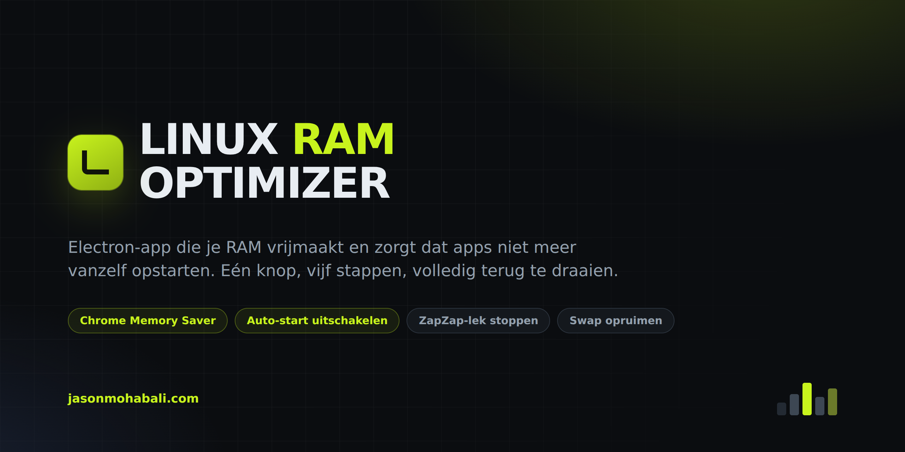
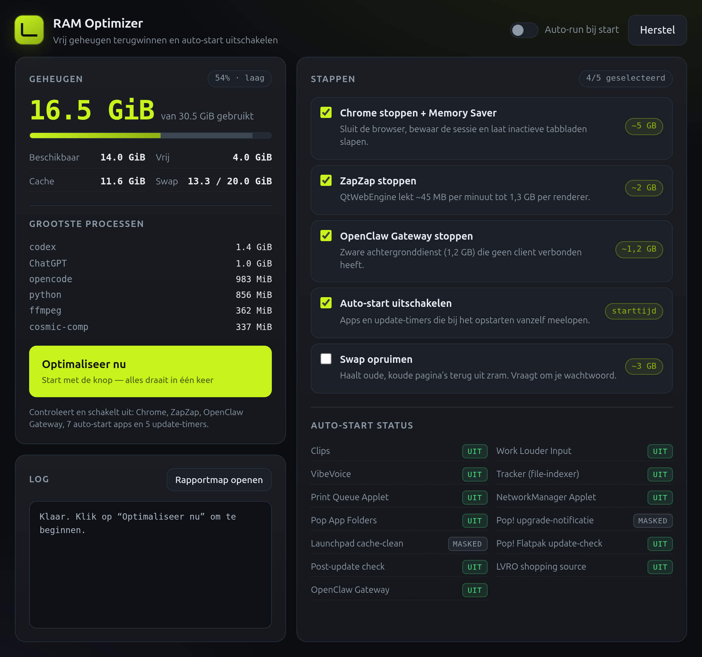
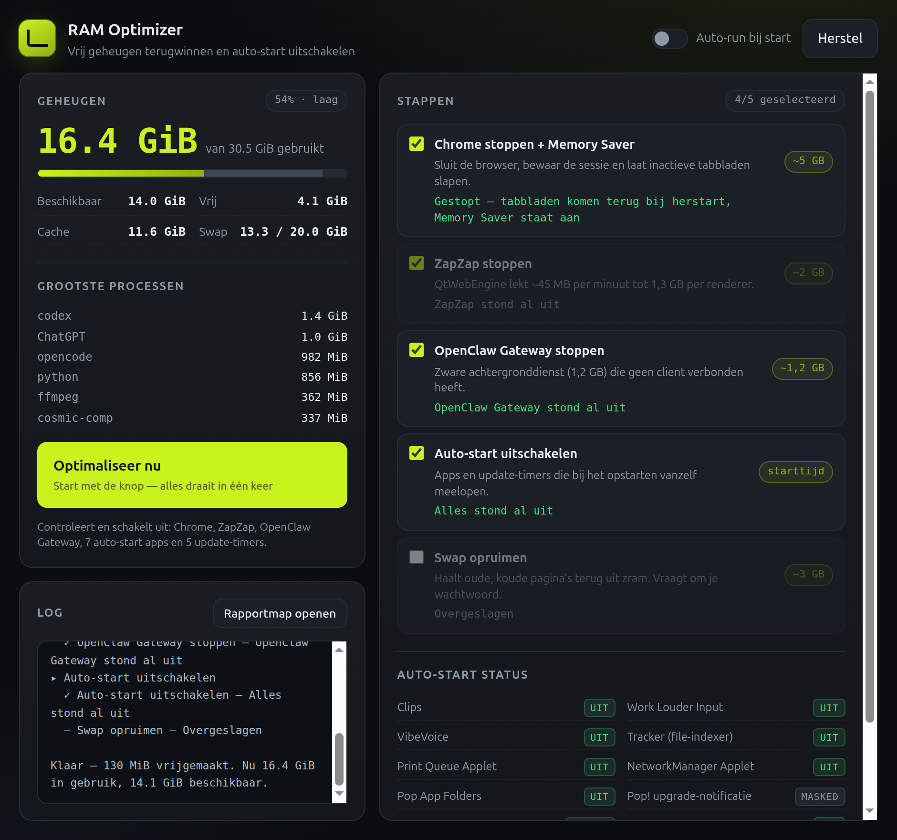
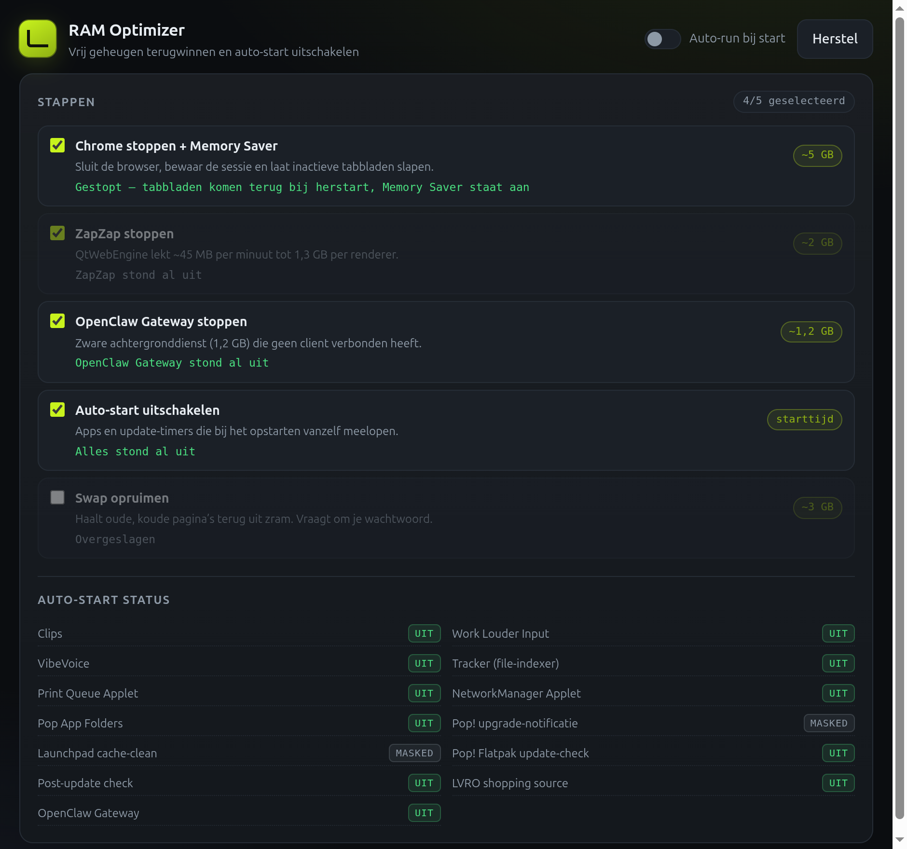
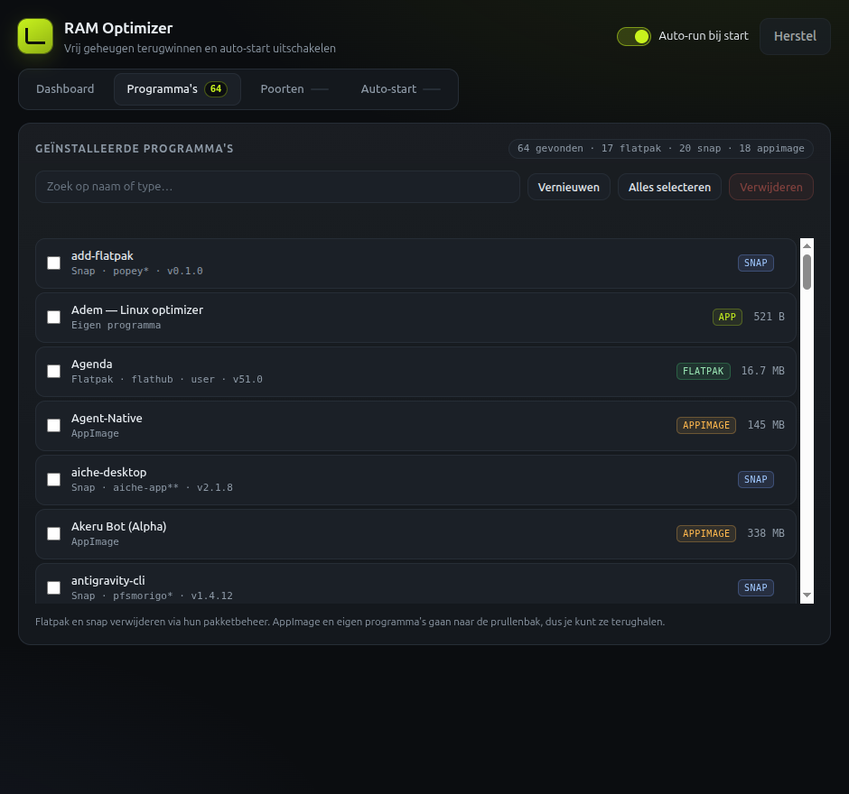
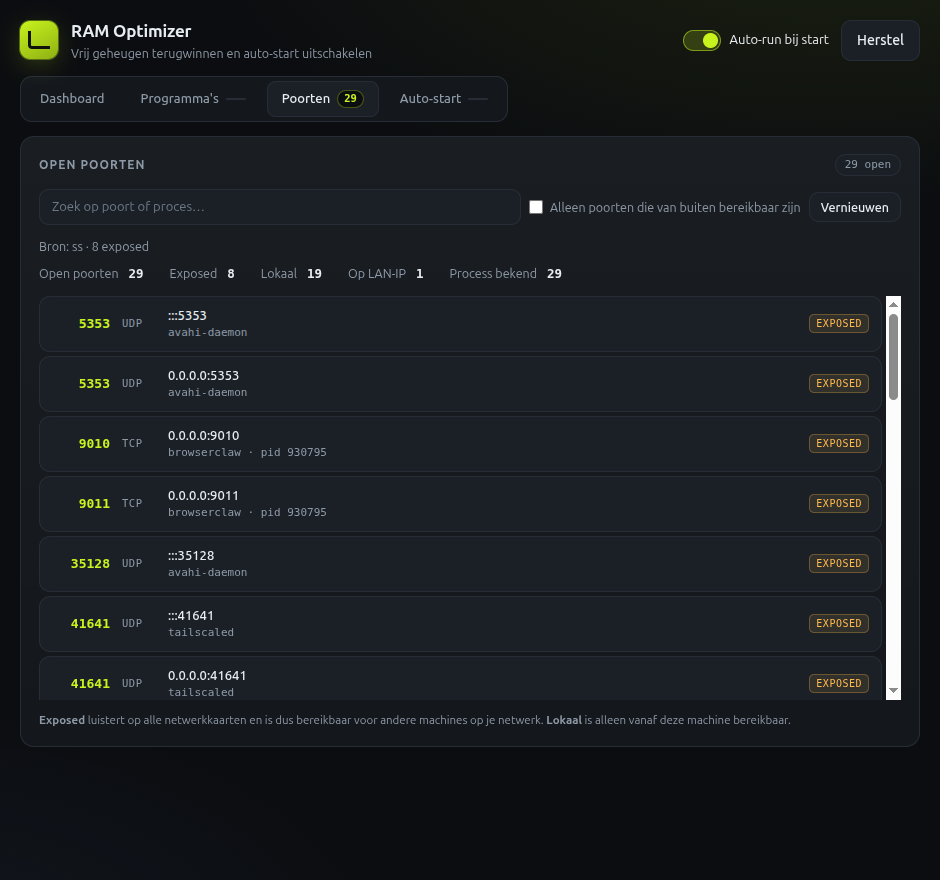
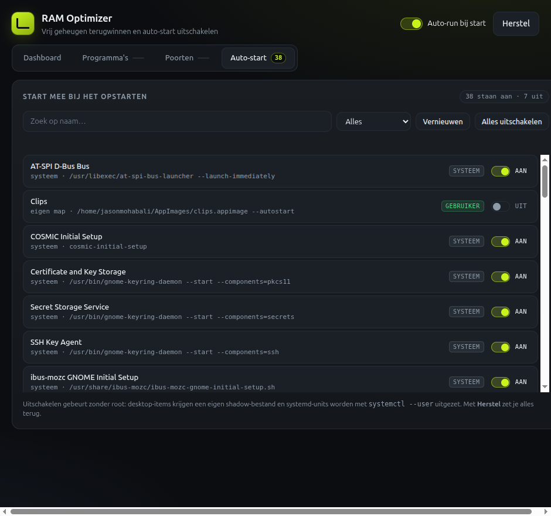

<p align="center">
  
</p>

<p align="center">
  <b>Electron-app die je RAM vrijmaakt en zorgt dat apps niet meer automatisch opstarten.</b>
</p>

<p align="center">
  <a href="https://jasonmohabali.com">🌐 jasonmohabali.com</a>
  &nbsp;·&nbsp;
  
  
  
</p>

---

## Wat doet het?

Op veel Linux-deskten draaien er tientallen apps en achtergronddiensten die
niemand gebruikt. Deze app doet in één klik wat je zelf ook zou doen:

- **Sluit Chrome** — maar bewaart je sessie, zodat alle tabbladen terugkomen
  zodra je hem heropent — en zet Chrome's *Memory Saver* aan zodat inactieve
  tabbladen hun geheugen vrijgeven.
- **Stopt ZapZap** — de QtWebEngine-renderers daarvan lekken ~45 MB per minuut,
  tot 1,3 GB per stuk.
- **Stopt OpenClaw Gateway** — 1,2 GB aan achtergronddienst.
- **Schakelt auto-start uit** — 7 apps en 5 update-timers die bij het opstarten
  vanzelf meelopen.
- **Ruimt de swap op** — haalt oude, koude pagina's terug uit zram. Vraagt om
  je wachtwoord via `pkexec`.

Alles is **volledig terug te draaien** met één knop: *Herstel*.

Daarnaast is de app uitgebreid met drie overzichten:

- **Programma's** — zie welke programma's je hebt (Flatpak, snap, AppImage en
  eigen programma's), selecteer ze en verwijder ze.
- **Poorten** — zie welke open poorten er draaien, welk proces ze vasthoudt en
  welke poorten ook vanaf andere machines bereikbaar zijn.
- **Auto-start** — zie alles wat bij het opstarten meeloopt en zet het per
  item aan of uit.

## Screenshots

| Dashboard | Na optimalisatie | Auto-start status |
|---|---|---|
|  |  |  |

| Programma's | Open poorten | Auto-start overzicht |
|---|---|---|
|  |  |  |

## Installatie

Download de AppImage en maak hem uitvoerbaar:

```bash
chmod +x RAM-Optimizer.AppImage
./RAM-Optimizer.AppImage
```

Of installeer hem in je applicatiemenu:

```bash
mkdir -p ~/.local/share/applications ~/.local/share/icons
cp RAM-Optimizer.AppImage ~/AppImages/
cp build/icon.png ~/.local/share/icons/ram-optimizer.png
cp docs/ram-optimizer.desktop ~/.local/share/applications/
update-desktop-database ~/.local/share/applications 2>/dev/null
```

## Gebruik

1. Start de app. De huidige situatie wordt gescand.
2. Tik op **Optimaliseer nu**. Elke stap logt wat er gebeurt.
3. Klaar. De RAM-gauge toont direct het verschil.

Met de schakelaar **Auto-run bij start** wordt de optimalisatie automatisch
uitgevoerd zodra je de app opent. Elke stap is uitvinkbaar.

Daarnaast zijn er drie tabbladen:

- **Programma's** — zoek, selecteer en verwijder programma's. AppImage en eigen
  programma's gaan naar de prullenbak, flatpak en snap via hun pakketbeheer.
- **Poorten** — zie wat er open staat. Zet *Alleen poorten die van buiten
  bereikbaar zijn* aan om te filteren op risicovolle poorten.
- **Auto-start** — per item aan of uitzetten, of in één keer alles uitschakelen.
  *Herstel* zet alles weer terug.

## Wat er technisch gebeurt

### Programma's verwijderen

De app kijkt op vier plekken:

| Bron | Herkennen | Verwijderen |
|---|---|---|
| Flatpak | `flatpak list --app` | `flatpak uninstall` (systeem-apps via `pkexec`) |
| snap | `snap list` | `snap remove` via `pkexec` |
| AppImage | AppImage-magic bytes in `~/AppImages`, `~/Applications`, `~/appimages`, `~/apps` en `~/.local/bin` | naar de XDG-prullenbak |
| Eigen programma's | desktop-bestanden in `~/.local/share/applications` die naar je eigen map wijzen | naar de XDG-prullenbak |

Bij AppImage en eigen programma's wordt het bestand **niet gewist maar naar de
prullenbak verplaatst** (`~/.local/share/Trash/files` + `.trashinfo`), inclusief
de bijbehorende snelkoppelingen. Alles buiten je eigen homedirectory wordt
geweigerd, en de RAM Optimizer zelf kan zichzelf niet verwijderen.

### Open poorten

De scan gebruikt `ss -H -tulnpe` en koppelt socket-inodes aan eigen processen
via `/proc/<pid>/fd`. Zonder `ss` wordt teruggevallen op `/proc/net/tcp{,6}` en
`/proc/net/udp{,6}`. Elke poort krijgt een label:

| Label | Betekenis |
|---|---|
| `exposed` | luistert op alle netwerkkaarten — dus bereikbaar vanaf andere machines |
| `lokaal` | alleen vanaf deze machine bereikbaar (`127.0.0.1` / `::1`) |
| `LAN-IP` | alleen op een specifiek lokaal IP |

### Auto-start

Auto-start items worden dynamisch opgepakt, niet uit een vaste lijst:

| Soort | Herkennen | Uitschakelen |
|---|---|---|
| Eigen desktop-items | `~/.config/autostart/*.desktop` | `Hidden=true` in het bestand zelf, origineel bewaard in `~/.config/autostart/disabled-by-ram-opt/` |
| Systeem desktop-items | `/etc/xdg/autostart/*.desktop` | shadow-bestand in `~/.config/autostart/` — geen root nodig |
| systemd user units | `systemctl --user list-unit-files --state=enabled` | `disable --now` (+ `mask` bij timers) |

Alles wat je hier uitzet staat in `~/.local/state/ram-optimizer/autostart-state.json`
en wordt door *Herstel* weer aangezet.

### Chrome

Twee dingen die je moet weten:

1. **Chrome herstart zichzelf na een onzuivere exit.** Chrome 156 schrijft dan
   `profile.exit_type = "Crashed"` in zijn profiel en start bij de volgende
   lancering opnieuw op om de crash-restore te tonen. De app zet
   `profile.exit_type = "Normal"` — daardoor blijft Chrome écht staan.
2. **Memory Saver heet intern**
   `performance_tuning.high_efficiency_mode.state` in het bestand
   `Local State`. Die pref zet de app. De plek om het te zien is
   `chrome://settings/performance`.

De sessie wordt bewaard via `session.restore_on_startup = 1`, zodat al je
tabbladen terugkomen bij de volgende start.

### Auto-start uitschakelen

| Soort | Methode |
|---|---|
| Gebruikers-apps (`~/.config/autostart/`) | `Hidden=true` + `X-GNOME-Autostart-enabled=false` |
| Systeem-apps (`/etc/xdg/autostart/`) | Shadow-bestand in `~/.config/autostart/` met `Hidden=true` — geen root nodig |
| systemd user timers | `disable` + `mask` |
| systemd user services | `disable` (+ `stop`) |

### Herstel

Originele bestanden worden bewaard in:

| Pad | Inhoud |
|---|---|
| `~/.config/google-chrome/Default/Preferences.bak-ram-opt` | Originele Chrome-prefs |
| `~/.config/google-chrome/Local State.bak-ram-opt` | Originele Chrome Local State |
| `~/.config/autostart/disabled-by-ram-opt/*.orig` | Originele auto-start-bestanden |
| `~/.config/systemd/user/disabled-services/*.disabled` | Originele unit-bestanden |
| `~/.local/state/ram-optimizer/autostart-state.json` | Welke auto-start items zijn uitgezet |

Rapporten van elke run komen in `~/.local/state/ram-optimizer/`.

Verwijderde programma's (AppImage en eigen programma's) komen in de
XDG-prullenbak: `~/.local/share/Trash/files/` met een `.trashinfo` in
`~/.local/share/Trash/info/`.

## Beveiliging

- De renderer draait met `contextIsolation: true`, `nodeIntegration: false`,
  `sandbox: true` en een strenge CSP (`default-src 'none'`).
- Alle commando's lopen via `execFile` met argument-arrays — geen
  shell-interpolatie, dus geen injectie via bestandsnamen.
- Alleen het profiel van de huidige gebruiker wordt aangeraakt.
- Verwijderen kan alleen binnen je eigen homedirectory; bestanden daarbuiten
  worden geweigerd en de RAM Optimizer zelf kan zichzelf niet verwijderen.
- Programma's die je verwijdert gaan naar de XDG-prullenbak, dus te herstellen.
- Root is alleen nodig voor de swap-stap, voor system-flatpaks en voor het
  verwijderen van snaps — die lopen via `pkexec` met een echt
  systeem-wachtwoordvenster.

## Ontwikkelen

```bash
npm install
node node_modules/electron/install.js   # Electron-binary ophalen
npm start                               # app starten in ontwikkelmodus
```

### Bouwen

```bash
./build.sh
```

Levert `~/AppImages/RAM-Optimizer.AppImage`.

> `build.sh` bouwt bewust in een staging-map onder `/tmp`. electron-builder
> loopt anders omhoog naar `~/package.json` (dat `workspaces: ["."]` heeft),
> pakt dat project en faalt op ontbrekende dependencies.

### Projectstructuur

```
src/main.js           Electron main-proces, IPC, window
src/preload.js        Beperkte brug (contextBridge, sandboxed)
src/optimizer.js      Alle logica: scan, optimalisatie, herstel
src/programs.js       Programma-overzicht en verwijderen (flatpak/snap/AppImage)
src/autostart.js      Auto-start overzicht, aan/uit zetten en herstellen
src/network.js        Open poorten scannen
src/renderer/         Interface (HTML/CSS/JS, geen framework)
scripts/make-icon.mjs Genereert build/icon.png zonder externe tools
docs/                 Banner en screenshots
```

Ontwikkelhulp:

```bash
npx electron . --screenshot /tmp/scherm.png --tab=poorten
```

## Licentie

MIT — zie [LICENSE](LICENSE).

Gemaakt door [Jason Mohab-Ali](https://jasonmohabali.com).
